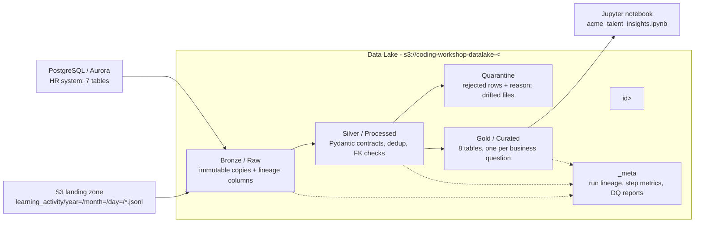

# Architecture

Follows the reference architecture in `docs/data-engineer.md`:
PostgreSQL + S3 → Bronze → Silver → Gold → Jupyter.



## Separation of concerns

| Concern | Module | Notes |
|---|---|---|
| Configuration | `common/config.py` | env vars only (`IS_LOCAL`, `POSTGRES_*`, `AWS_ENDPOINT_URL_S3`, `DATALAKE_BUCKET`) |
| Logging | `common/logger.py` | JSON lines, INFO / WARN / ERROR, `run_id` on every line |
| Retry / backoff | `common/retry.py` | exponential backoff + jitter for PostgreSQL / S3 |
| Storage adapters | `common/storage.py`, `common/postgres.py` | the only modules that touch S3 / PostgreSQL |
| Spark | `common/spark.py` | one session factory; Arrow conversion with row-count guard |
| Lineage | `common/lineage.py` | counts, timings and status per step and per run |
| Schema contracts | `contracts/` | Pydantic models mirroring `schema.sql`; run inside Spark via `mapInArrow` |
| Source bootstrap | `seed/` | simulates the upstream systems (not part of the medallion flow) |
| Ingestion | `bronze/` | no transformation |
| Transformation | `silver/` | cleaning, validation, quarantine, reconciliation |
| Serving | `gold/` | business aggregates + grain/reconciliation checks |

## Storage layout and paths

```
s3://coding-workshop-datalake-<id>/
├── landing/
│   ├── learning_activity/year=YYYY/month=MM/day=DD/events-000.jsonl   S3 source system
│   └── postgres_seed/*.csv, schema.sql                               seeds PostgreSQL
├── bronze/
│   ├── hr/<table>/ingest_date=YYYY-MM-DD/batch_id=<hash>/part-0.parquet
│   └── learning_activity/year=YYYY/month=MM/day=DD/<file>/part-0.parquet
├── silver/
│   ├── hr/<table>/part-0.parquet
│   ├── learning_events/event_year=YYYY/event_month=MM/part-0.parquet
│   └── reference/course_competency_map/part-0.parquet
├── quarantine/
│   ├── <entity>/part-0.parquet                     entity, reason, record_json, source_file, line_number, ...
│   └── files/landing/learning_activity/.../events-000.jsonl (+ .reason.json)
├── gold/<table>/part-0.parquet
└── _meta/
    ├── pipeline_runs/run_id=<id>/run.json          job start/end/duration/status + all steps
    ├── step_metrics/run_id=<id>/part-0.parquet     queryable step metrics
    └── dq_reports/{latest, run_id=<id>}/report.json
```

## Partitioning and file layout

- **Bronze events** keep the source's `year=/month=/day=` partitions (data-engineer.md §6), one folder per source file, so ingestion is incremental per file.
- **Silver events** are partitioned by `event_year=/event_month=`, the natural filter for activity analysis (≈ 37 partitions; daily partitions would create tiny files).
- **HR tables and Gold** are small (≤ 25k rows) and stored unpartitioned. Partitioning them would only add small-file overhead.
- Parquet everywhere after landing: columnar, compressed, schema embedded.

## Idempotency and incremental safety

| Layer | Strategy | Rerun result |
|---|---|---|
| landing | upload only if missing or the size differs; sizes verified against source | skipped |
| seed (PostgreSQL) | load only if table counts differ from the CSVs, in one transaction | skipped |
| Bronze HR | snapshot id = content hash; existing snapshot found means skip | skipped (immutable) |
| Bronze events | per source file; existing file folder means skip | only new files ingested |
| Silver / quarantine / Gold | full deterministic rebuild from the previous layer (overwrite) | identical output |

Verified by `tests/integration/test_pipeline_end_to_end.py::test_second_run_is_idempotent`
(SHA-256 of every Silver/Gold/quarantine table identical across two runs).

## Runtime: local vs cloud (same code, env vars only)

| | Local (VDI) | Cloud (AWS) |
|---|---|---|
| Runs as | `python job.py` | Kubernetes Job on EKS (Helm), created by `bin/deploy-backend.sh` |
| PostgreSQL | local PostgreSQL `postgres/postgres123` | Aurora PostgreSQL Serverless v2, `sslmode=require` |
| S3 | LocalStack (`AWS_ENDPOINT_URL_S3`) | AWS S3 bucket from `infra/s3.tf` |
| Landing data | `landing` stage uploads `backend/_source` | Terraform `null_resource.datalake_landing` syncs `backend/_source` before the job |
| Notebook | Jupyter on `localhost:8888` | JupyterHub on EKS (`kubectl port-forward svc/proxy-public 8080:80`) |

## Infrastructure changes (outside `backend/`, wiring only)

| File | Change | Reason |
|---|---|---|
| `infra/locals.tf` | `backend/*/job.py` folders become EKS jobs, not Lambdas; job env vars | Spark can't run in a 128 MB Lambda |
| `infra/eks.tf` | ship the whole job folder (tar.gz in ConfigMap); pass env vars + Secret; sync landing data first | the default Helm setup only shipped `job.py` and no env vars |
| `infra/helm/templates/python-job.yaml`, `values.yaml` | bundle, `env`, `secretEnv`, writable `/app` | same |
| `infra/s3.tf`, `infra/output.tf` | data lake bucket (private, encrypted) + output | no data lake bucket existed |
| `bin/start-dev.sh` | skip `job.py` folders when vendoring Lambda dependencies | avoid copying PySpark into the source tree |
